# Verso

**Say it. Read it. One red ribbon marks your place.**

Verso is a recorder that writes down what you say, and a reader that speaks what you read. It is designed for iPhone Duo, where the fold is the spine of a book. Everything runs on the phone: no account, no upload.

<p align="center">
  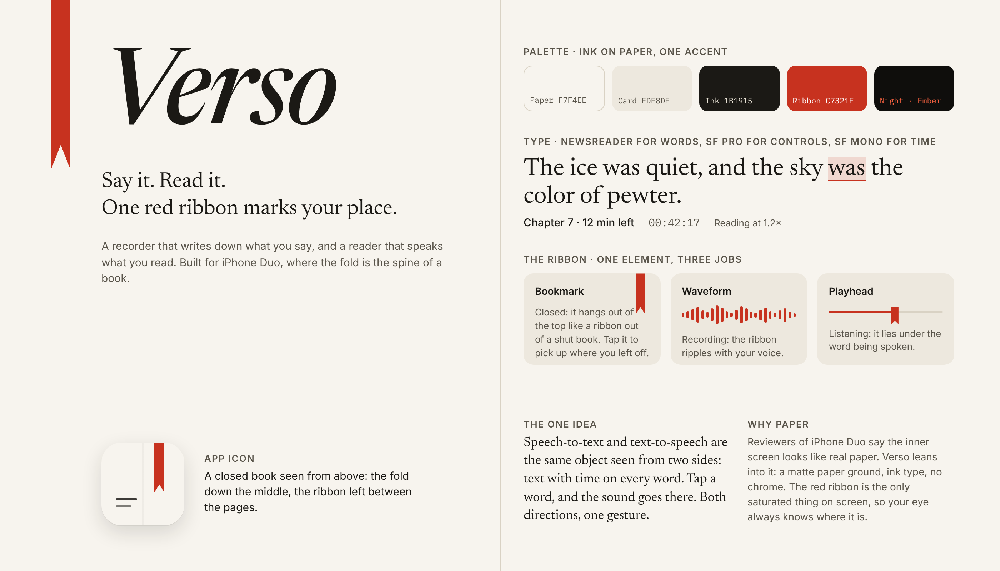
</p>

- **Xcode project:** `Verso.xcodeproj`. SwiftUI, SwiftData, Speech, AVFoundation, PDFKit. No third-party code. See [Build and run](#build-and-run).
- **Design canvas (interactive, with notes):** https://claude.ai/artifact/SbNz7DXvZHtP676Y3quN9t
- **Build spec:** [DESIGN.md](DESIGN.md) covers the data model, architecture, pose rules, and the build plan.
- **Artboard sources:** [design/canvas](design/canvas). Re-render the screenshots with `node design/render.mjs`.

## Build and run

Requirements: a Mac with **Xcode 27.1 or later**. The project uses the iOS 27.1 SDK for the fold APIs. Everything else is standard Apple frameworks.

```
git clone https://github.com/tone2k/speakread.git
cd speakread
open Verso.xcodeproj
```

1. In Xcode, select the **Verso** target, then **Signing & Capabilities**, and choose your team. The bundle identifier is `com.tone2k.verso`. Change it if your team already uses it.
2. Pick a run destination. **iPhone Duo** in the simulator folds from the Simulator menu. Your own Duo works over a cable or Wi‑Fi once it is paired with Xcode.
3. Press Run.

On the first recording, iOS asks for the microphone and speech recognition. With the default **Apple on-device** ears, iOS downloads the speech model for your language once, then works offline.

### What is in the project

| Folder | What it does |
|---|---|
| `Verso/App` | App entry, the `Engine` that owns audio and settings, the Siri intent ("Hey Siri, start Verso") |
| `Verso/Model` | `TimedText`, the shared model: text with a time on every word. SwiftData `Document` and `Note` |
| `Verso/Audio` | `Recorder` (microphone to file plus live transcript), `Reader` (book to speech with word highlighting), `Player` (recordings), two `Ears` engines |
| `Verso/Import` | EPUB (with a small built-in zip reader), PDF, and audio file import |
| `Verso/Layout` | `Fold`: pose from reserved regions. `Spread`: two views around the spine. `WordFlow`: tappable words. `Pagination` |
| `Verso/Design` | The theme and the ribbon views |
| `Verso/Screens` | Pocket, Shelf, Recording, Reading, Listening, Nightstand, Playback, Settings |

### How the fold is handled

`Fold.swift` reads `reservedRegions(kind: .division)` in a `GeometryReader`. An active division means the phone is partly folded: a vertical one is book pose, a horizontal one is laptop pose. An inactive division is the spine of the open phone. Compact width is the closed phone. Every screen switches layout on that one value, and nothing interactive is ever placed inside the division frame.

### Dialogues

Import a dialogue (Plato from Project Gutenberg as `.txt`, or any EPUB or PDF with `SPEAKER:` labels) and Verso casts it: one voice per character, a breath between turns, the speaker's name above the line being read. The Cast sheet lets you recast anyone and hear a line. In laptop pose the flat half becomes a stage with the speaking character lit. Everything runs on the phone. See [docs/dialogues.md](docs/dialogues.md).

### The stream layer

Verso's look is an instrument, so every screen that moves audio shows the data underneath it, not a picture of it. A stream line carries sample counts in hex, span offsets, and the buffer of words whose audio is already prepared ahead of the playhead, reported by the Kokoro scheduler or the Apple utterance window. Buffered words carry a dotted underline in the text. The level shows as eight bits. The live transcript ends in a write head with its lag. Playback has a RAW view: the timed text as packets, tap a row to seek. Page turns reveal from the leading edge like a buffer flush. The ground is a 1-bit dither drawn once and tiled by the GPU. Nothing in this layer runs at the data rate outside a leaf view.

### Not yet done

- Parakeet, Whisper and SenseVoice engines. The `Ears` protocol is ready for them. Apple's on-device SpeechAnalyzer and classic dictation ship now.
- Tent pose is a manual Nightstand button, because the SDK reports tent and laptop the same way.
- Page breaks are estimated, not measured. Long words near a page edge can wrap one line early.

## The one idea

Speech-to-text and text-to-speech are the same object seen from two sides: text with a time on every word. A transcript is timed text made from audio. A book read aloud is timed text made into audio. One data model serves both, so one gesture serves both. Tap a word, and the sound goes there.

## Closed · 5.4-inch outer display

One hand, one thumb. The ribbon hanging from the top edge is the whole "now playing" interface. It is a ribbon out of a shut book: tap it to pick up where you left off. The record button is where the thumb already rests.

<p align="center">
  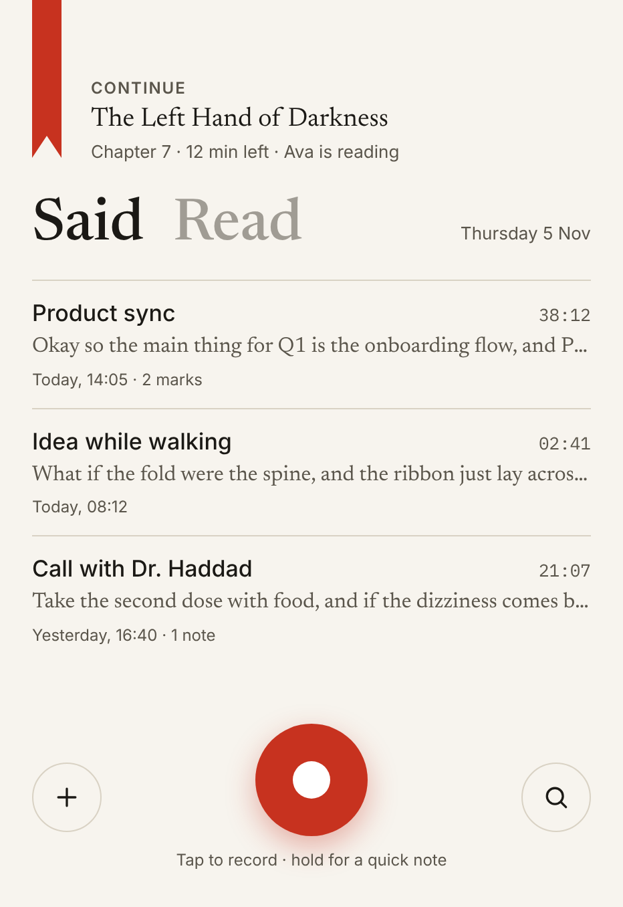
  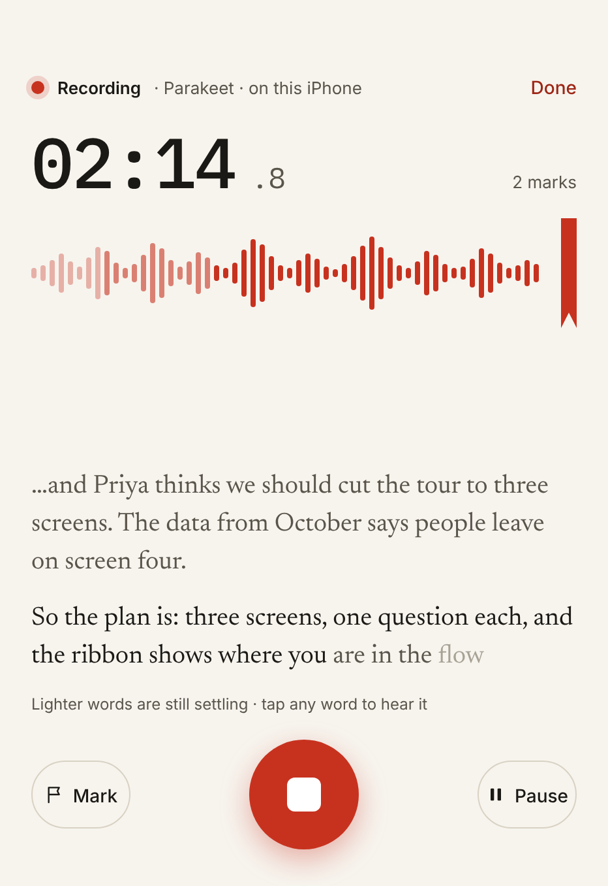
  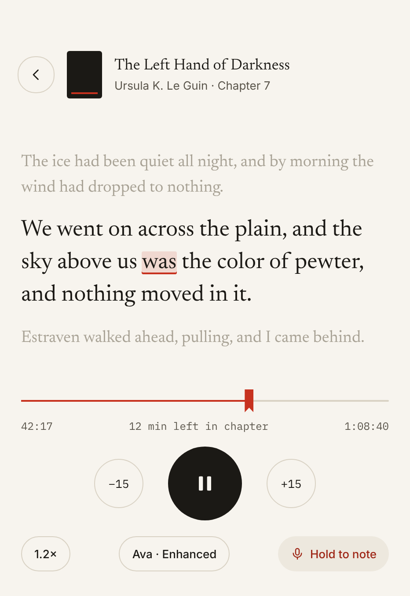
  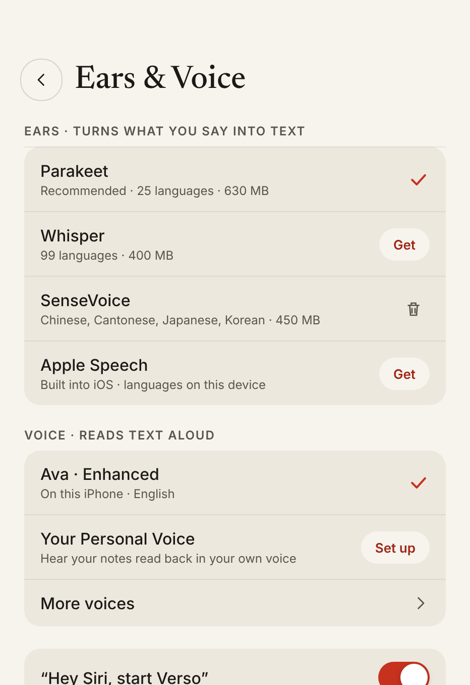
</p>

## Open flat · 7.6-inch inner display

The fold is the spine. The two tab words on the closed phone, Said and Read, become the two page headings when the phone opens. Nothing interactive ever sits on the crease. The control rail lives on the right edge, under the thumb.

<p align="center">
  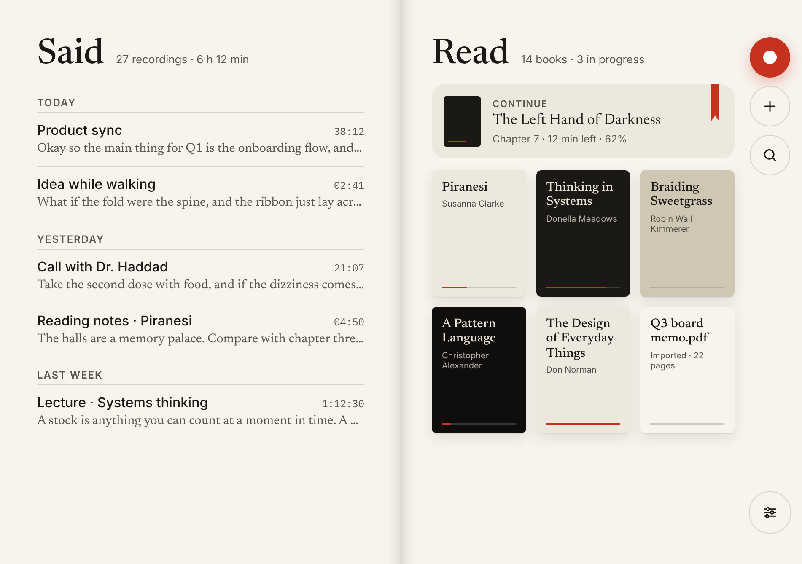
</p>

<p align="center">
  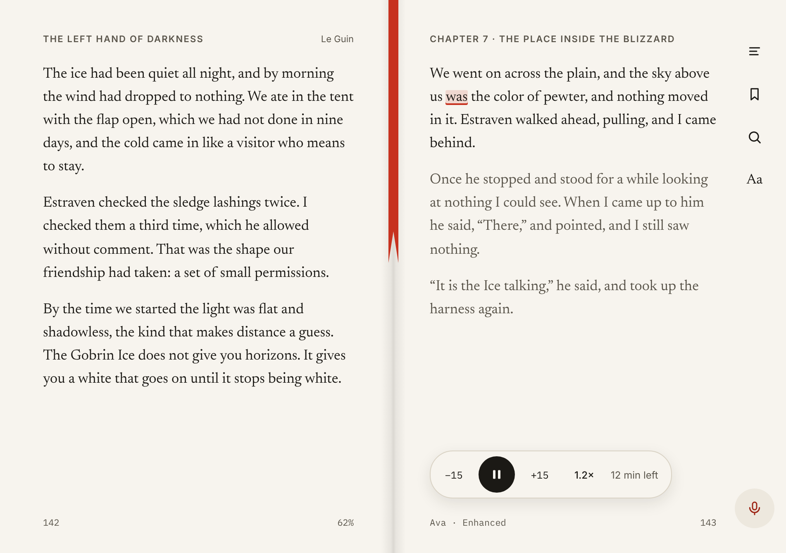
</p>

<p align="center">
  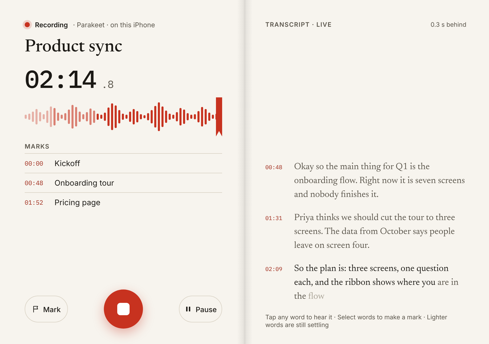
</p>

## Half-folded poses

The hinge holds any angle from 15 to 165 degrees. Verso does not branch on a pose name. It reads three runtime facts: the size classes, whether a fold region is active, and which way the fold runs.

| Laptop pose · Lectern | Tent pose · Nightstand |
|---|---|
| 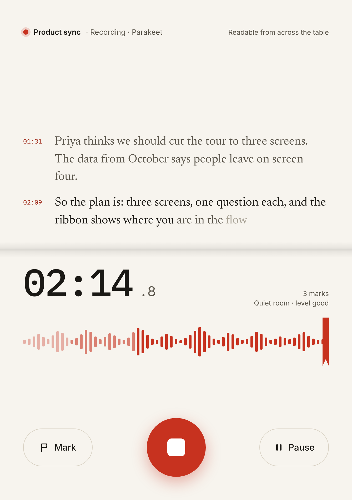 | 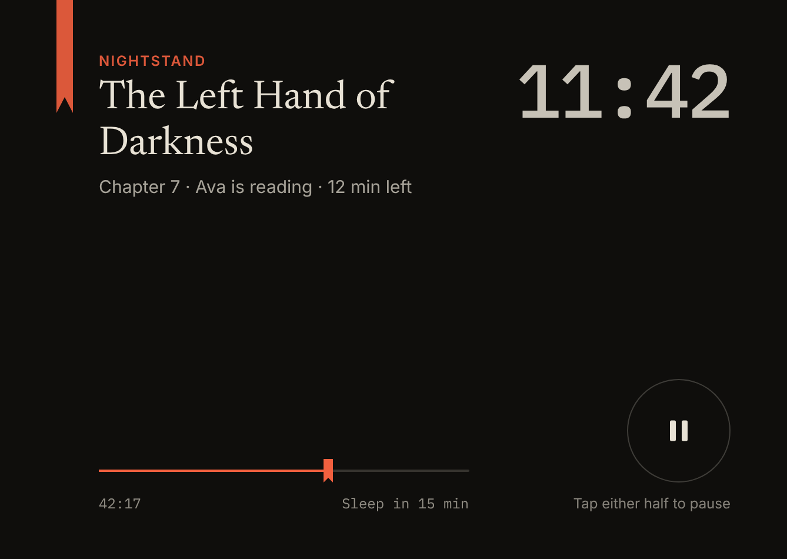 |
| Text rises to the upright half, large enough to read across a table. Controls drop to the flat half where fingers rest. | Dark paper, ember red, the chapter and a sleep timer. A tap on either half pauses. |

<p align="center">
  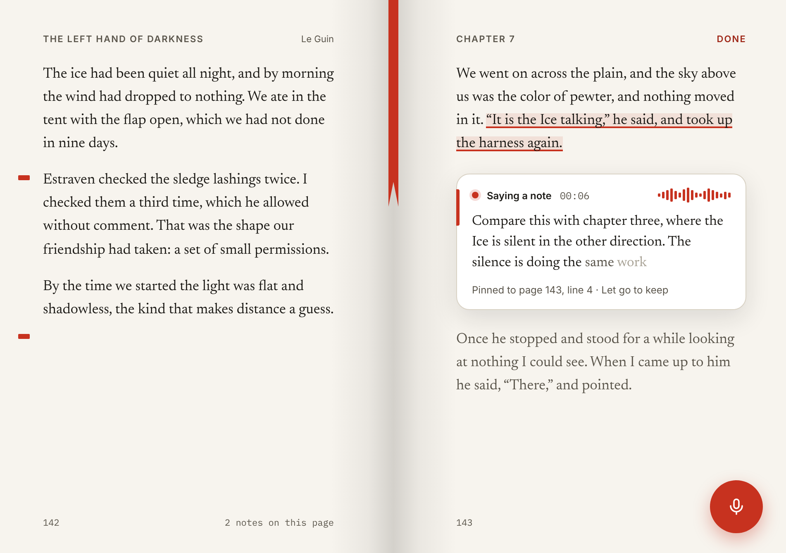
</p>

**Book pose · Margin note.** This is where recorder and reader meet. Hold the corner, speak, let go. The note is transcribed on the phone and pinned to the sentence being read, marked by a small red knot in the margin. Later, "Read my notes back" plays your notes in your own Personal Voice, in book order.

## Continuity

The phone changes shape. Verso keeps its place. Sound never stops, and the ribbon never moves without you.

<p align="center">
  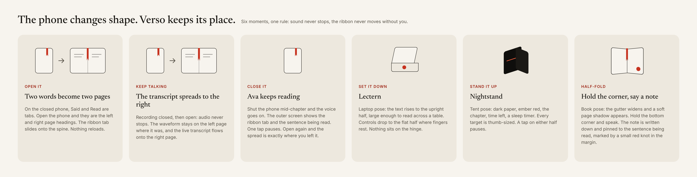
</p>

## The look

- **Ink on paper.** Paper `#F7F4EE`, ink `#1B1915`, cards `#EDE8DE`. Night mode uses `#0F0E0C` with ember `#F2603F`.
- **One accent.** Ribbon red `#C7321F` is the only saturated color on screen. It is the bookmark when closed, the waveform when recording, and the playhead when listening.
- **Type.** Newsreader for reading text and headings, SF Pro for controls, SF Mono for time. The renders use Inter and IBM Plex Mono in place of SF.
- **No chrome.** No tab bar, no toolbar backgrounds. Liquid Glass appears only on the floating transport pill and system sheets.

## Engines

| Ears (speech to text) | Voice (text to speech) |
|---|---|
| Apple SpeechAnalyzer, Parakeet v3, Whisper, SenseVoice | Apple Enhanced voices, Personal Voice, optional on-device neural voice |

All engines run on the phone. Downloads are optional and listed with their size and languages.

## Rendering the screenshots

```
node design/render.mjs
```

Needs Node 22 and Playwright with Chromium. If Playwright is installed globally, run with `NODE_PATH=$(npm root -g)`.
